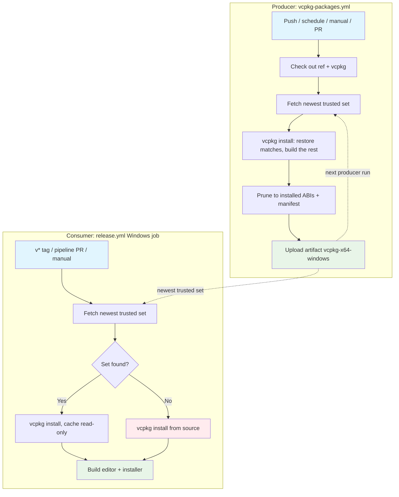

## Workflow Overview

**Purpose**: Build Scenery Editor X's vcpkg dependencies once per change and keep them as one prebuilt package set
that every release build (release, patch, alpha, beta) restores instead of compiling the ports again.
**Trigger Events**: dependency changes on `dev` / `release` / `master`; a weekly schedule; a manual run; pull requests
that change the dependency set (validation only).
**Target Environments**: CI only. Producer: `vcpkg-packages.yml`. Consumer: `release.yml` (Windows installer job).
Triplet `x64-windows` (the only shipped package today).

| Term | Meaning |
|---|---|
| Package | One vcpkg port built for the triplet, stored as `<first two hex digits>/<ABI>.zip` |
| ABI | SHA-256 of the package's `vcpkg_abi_info.txt`: port version, features, triplet, compiler and dependency ABIs |
| Package set | The folder of packages one producer run leaves, plus `manifest.json`; uploaded as artifact `vcpkg-x64-windows` |
| Trusted run | A producer run on `dev` / `release` / `master` started by a push, the schedule, or by hand (all need write access) |
| Restore | vcpkg copying a package whose ABI matches instead of building it |

## Execution Flow Diagram



## Jobs & Dependencies

| Job Name | Purpose | Dependencies | Execution Context |
|----------|---------|--------------|-------------------|
| `windows` (producer, "x64-windows packages") | Build changed ports, prune, upload the set | None | Windows hosted runner, `contents: read`, `actions: read` |
| `windows` (consumer, release.yml "Windows installer") | Restore the set, build editor + installer | release gate | Windows hosted runner, `contents: read`, `actions: read` |

## Requirements Matrix

### Functional Requirements

| ID | Requirement | Priority | Acceptance Criteria |
|----|-------------|----------|-------------------|
| REQ-001 | Produce one package set covering every port `vcpkg.json` installs for the triplet | High | `manifest.json` lists every port in `vcpkg_installed/<triplet>/share`; no "installed but not in the cache" warning |
| REQ-002 | Rebuild only ports whose ABI changed | High | A producer run with an unchanged manifest and compiler restores all packages and builds none |
| REQ-003 | Keep only packages the current manifest uses | Medium | After pruning, the set holds exactly one package per installed port (plus `manifest.json`) |
| REQ-004 | Release builds use the newest trusted set, read-only | High | Consumer log names the run it took; vcpkg reports restored packages; the consumer never uploads or alters a set |
| REQ-005 | Release builds still succeed without a set | High | No trusted set or an expired one: a warning, then every port builds from source |
| REQ-006 | Mismatched packages are rebuilt, never used | High | vcpkg restores only exact ABI matches (guaranteed by the binary cache's ABI naming) |
| REQ-007 | Refresh weekly | Medium | A scheduled run each week builds `dev`'s manifest with the current runner compiler and re-uploads (new 90-day retention) |
| REQ-008 | Pull requests that change dependencies are validated | Medium | The producer runs on such pull requests and uploads a 7-day set that no other run uses |
| REQ-009 | The set is ref-agnostic | High | Any branch or tag (release, patch, alpha, beta, PR dry run) can use it; nothing is scoped to the producing ref |

### Security Requirements

| ID | Requirement | Implementation Constraint |
|----|-------------|---------------------------|
| SEC-001 | Only trusted runs' sets are used | Fetch keeps runs whose event is push, schedule or workflow_dispatch and whose branch is dev, release or master; pull request runs, and manual runs on other branches (they run that branch's copy of the workflow), are skipped even when newer |
| SEC-002 | Consumers can't change the set | The consumer's binary source is read-only; only the producer uploads |
| SEC-003 | Least privilege | Producer and consumer jobs: `contents: read`, `actions: read`; no secrets; the workflow token only |
| SEC-004 | Only GitHub-owned actions | The repository's Actions policy allows `actions/*` and two listed actions; anything else stops the workflow |
| SEC-005 | Provenance is inspectable | Each set carries `manifest.json` (ports, versions, ABIs, vcpkg commit); the consumer's run summary links the producing run |

### Performance Requirements

| ID | Metric | Target | Measurement Method |
|----|-------|--------|-------------------|
| PERF-001 | Consumer vcpkg phase with a matching set | Under 5 minutes (vs about an hour cold) | Duration of the consumer's "vcpkg ports" step |
| PERF-002 | Producer run with no changes | Under 10 minutes | Producer run duration |
| PERF-003 | Package set size | About 250 MB for the current 33 ports | `manifest.json` / run summary |
| PERF-004 | Restore ratio on a release | 100% with an unchanged manifest and runner compiler | vcpkg's "Restored N package(s)" vs ports installed |

## Input/Output Contracts

### Inputs

```yaml
# Repository content
vcpkg.json: file                    # The dependency manifest (ports, features)
dependency/vcpkg: submodule         # vcpkg tool + port tree (its commit fixes port versions)
cmake/toolchains/sedx-windows.cmake: file
# Environment
VCPKG_BINARY_SOURCES: string        # Producer: files,<cache>,readwrite. Consumer: files,<cache>,read
GH_TOKEN: secret                    # The workflow token, for finding and downloading the previous set
BUILD_REF: string                   # Producer: manual input `ref` (default dev); schedule: dev; else the triggering ref
# Triggers (producer)
branches: [dev, release, master]    # push
paths: [vcpkg.json, dependency/vcpkg, sedx-windows.cmake, build_release_windows.ps1, vcpkg_prebuilt.ps1, the workflow]
schedule: weekly (Monday 04:17 UTC)
```

### Outputs

```yaml
vcpkg-x64-windows: artifact         # The package set: <2 hex>/<ABI>.zip per port + manifest.json; 90 days (PR runs: 7)
manifest.json: file                 # triplet, created (UTC), vcpkg commit, packages[{port, version, abi, bytes}]
found/run/branch: step outputs      # Fetch: whether a set was found, the run it came from, its branch
run summary: markdown               # Producer: package table. Consumer: which run's set was used, or that none was
```

### Secrets & Variables

| Type | Name | Purpose | Scope |
|------|------|---------|-------|
| Token | `GITHUB_TOKEN` | List producer runs, download their artifact | Job (`actions: read`) |
| Variable | `ARTIFACT` / `TRIPLET` | Artifact name, vcpkg triplet | Producer workflow |

## Execution Constraints

### Runtime Constraints

- **Timeout**: producer 240 minutes (cold build of every port); consumer job 300 minutes overall.
- **Concurrency**: trusted producer runs are serialized (each starts from the previous set); pull request runs are grouped per pull request and cancel older ones.
- **Resource Limits**: hosted Windows runner (4 vCPU, 16 GB); artifact retention at most 90 days for a public repository.

### Environmental Constraints

- **Runner Requirements**: same Windows image family for producer and consumer, so the compiler (part of every ABI) matches.
- **Network Access**: GitHub (checkout, API, artifacts) and the port sources vcpkg downloads when building.
- **Permissions**: `contents: read`, `actions: read`.
- **Path length**: vcpkg build trees go to a short folder (`C:\vb`); some ports exceed 260 characters under the checkout path.

## Error Handling Strategy

| Error Type | Response | Recovery Action |
|------------|----------|-----------------|
| No producer runs / workflow not on the default branch | Warning; empty cache | Consumer builds from source; run the producer manually |
| Newest trusted set expired | Skipped; older unexpired sets tried | Weekly run re-uploads; or run the producer manually |
| Download fails | Step fails (a half-downloaded set is never used) | Re-run the job |
| Port build fails (producer) | Job fails, vcpkg logs uploaded (7 days) | Fix the port / manifest; the previous set stays the newest trusted one |
| Installed port missing from the cache after a build | Warning in the producer, set uploaded without it | Investigate vcpkg's binary cache write; consumers build that port |
| Compiler changed on the runner image | ABIs differ, packages not restored | Consumer builds from source; the next producer run (push or weekly) catches up |

## Quality Gates

### Gate Definitions

| Gate | Criteria | Bypass Conditions |
|------|----------|-------------------|
| Trust | Set from a push / schedule / manual run | None |
| Completeness | Every installed port present after pruning | Warning only: consumers build the missing ports |
| ABI match | vcpkg restores a package only when its ABI equals the build's | None (vcpkg enforces it) |
| Release integrity | The consumer's editor build, installer and smoke test pass (release.yml) | None |

## Monitoring & Observability

### Key Metrics

- **Success Rate**: producer runs succeed except on genuine port failures.
- **Execution Time**: producer with no changes under 10 minutes; consumer vcpkg phase under 5 minutes with a matching set.
- **Resource Usage**: set size in the producer summary; artifact storage in the repository's Actions usage.

### Alerting

| Condition | Severity | Notification Target |
|-----------|----------|-------------------|
| Producer run fails | Medium | GitHub's failed-workflow notification to the run's actor / repository watchers |
| Consumer finds no set | Low | `::warning::` annotation on the release run |
| Installed port missing from a set | Low | `::warning::` annotation on the producer run |

## Integration Points

### External Systems

| System | Integration Type | Data Exchange | SLA Requirements |
|--------|------------------|---------------|------------------|
| GitHub Actions artifacts | Upload / download | Zip folder of packages + JSON manifest | Retention 90 days; refreshed weekly |
| GitHub REST API | Query (via `gh`) | Producer runs (event, branch, date), their artifacts | Workflow token rate limits |
| vcpkg binary cache ("files" provider) | Local folder | ABI-named package zips | Same vcpkg version on both sides (the submodule) |

### Dependent Workflows

| Workflow | Relationship | Trigger Mechanism |
|----------|--------------|-------------------|
| `release.yml` | Consumer (Windows installer job) | Fetches the newest trusted set at run time |
| `vcpkg-packages.yml` (later runs) | Consumer of its own previous set | Fetch at the start of each run |
| `unit-tests.yml` | None (needs no vcpkg ports) | — |

## Compliance & Governance

### Audit Requirements

- **Execution Logs**: GitHub's run logs (repository retention); each consumer summary names the producing run.
- **Approval Gates**: none for the producer; releases are gated by `release.yml` (tag on `release`, gate checks).
- **Change Control**: changes to this workflow, the scripts or the manifest go through pull requests into `dev` (the producer validates them).

### Security Controls

- **Access Control**: only users with write access can start a trusted producer run.
- **Secret Management**: none; the short-lived workflow token only.
- **Vulnerability Scanning**: port versions come from the pinned vcpkg submodule; updating it is a reviewed change.

## Edge Cases & Exceptions

### Scenario Matrix

| Scenario | Expected Behavior | Validation Method |
|----------|-------------------|-------------------|
| Pull request run is newer than every trusted run | Ignored by Fetch; the newest trusted set is used | Fetch log names a push / schedule / manual run |
| `vcpkg.json` adds a port | Producer builds it, set grows; releases before the next producer run build it themselves | Producer manifest; consumer restore count |
| `vcpkg.json` removes a port | Prune drops its package | Package count in the summary |
| vcpkg submodule updated | Changed ports rebuild; unchanged ABIs restore | Producer build list |
| Runner image updates MSVC | All ABIs change: full rebuild in the next producer run; releases in between build from source | Producer duration spike |
| Release from `release` while the newest set was built from `dev` | Matching ports restore (same manifest at merge time) | Consumer restore count |
| Producer runs concurrently with a release | Release uses the newest set that existed when it fetched | Consumer summary |
| Fork pull request changes the scripts | Its run uploads a set no one uses (SEC-001) | Fetch skips `pull_request` runs |
| Manual run on a feature branch | Its set is never used (SEC-001): that branch's workflow file could upload anything | Fetch skips runs off dev / release / master |
| Schedule before this workflow reaches `master` | No scheduled runs (schedules use the default branch's file) | Actions tab; run the producer manually |

## Validation Criteria

### Workflow Validation

- **VLD-001**: `actionlint` and `shellcheck` pass (Validate GitHub forms and workflows).
- **VLD-002**: Fetch, run locally against the repository, ignores pull request runs and runs off dev / release / master, and downloads the newest trusted run's artifact.
- **VLD-003**: Prune, run locally on a cache with extra packages, keeps exactly the installed ABIs and writes a valid `manifest.json`.
- **VLD-004**: A release dry run after a producer run reports restored packages and no port builds.

### Performance Benchmarks

- **PERF-001**: consumer "vcpkg ports" step under 5 minutes with a matching set.
- **PERF-002**: producer run with no dependency change under 10 minutes.

## Change Management

### Update Process

1. **Specification Update**: modify this document first.
2. **Review & Approval**: pull request into `dev`; the producer runs on it as validation.
3. **Implementation**: `.github/workflows/vcpkg-packages.yml`, `scripts/ci/vcpkg_prebuilt.ps1`, the consumer steps in `release.yml`.
4. **Testing**: the pull request's producer run (set uploaded, 7 days) and a release dry run.
5. **Deployment**: merge to `dev` (a trusted producer run follows); the schedule starts once the workflow reaches `master`.

### Version History

| Version | Date | Changes | Author |
|---------|------|---------|--------|
| 1.0 | 2026-11-27 | Initial specification | Scenery Editor X maintainers (with Claude Code) |
| 1.1 | 2026-11-28 | Trusted runs must also be on dev / release / master (manual runs on other branches skipped) | Scenery Editor X maintainers (with Claude Code) |

## Related Specifications

- [docs/RELEASING.md](../docs/RELEASING.md): the release procedure and release.yml
- [.github/workflows/README.md](../.github/workflows/README.md): every workflow and when it runs
- [installer/README.md](../installer/README.md): the Windows installer the consumer builds
